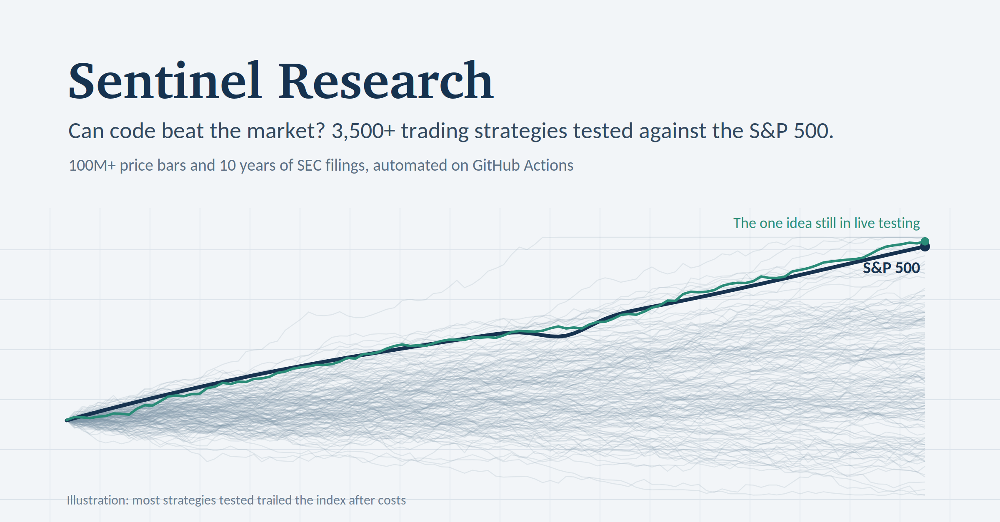
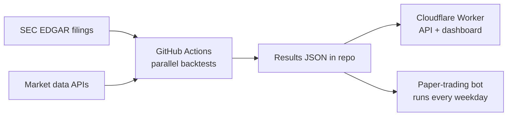

# Sentinel Research

An automated research platform for one question: **can a rules-based strategy beat simply holding the S&P 500 once real-world costs are counted?**

Sentinel pulls market data and SEC filings, runs large backtests in parallel on GitHub Actions, publishes the results to a dashboard, and paper trades any idea that survives, with no manual steps.

## Scale

| | |
|---|---|
| Strategy variants tested | 3,500+ |
| Price bars processed | ~100 million (1-minute, 5-minute and daily) |
| Earnings events analysed | 10 years of SEC 8-K filings |
| Markets covered | US stocks and ETFs, Indian ETFs, crypto futures |

## How it works

- **Data:** SEC EDGAR (financial statements and earnings filings), Alpaca market data, historical index membership.
- **Compute:** Node.js backtest engines run as GitHub Actions matrix jobs, split by year and universe, then merged.
- **Serving:** a Cloudflare Worker exposes the data as an API and an MCP server for AI assistants, plus a web dashboard.
- **Execution:** a scheduled bot trades the surviving idea on a paper (simulated) account at live prices.

## Research principles

Most backtests look great because they quietly cheat. Sentinel is built to avoid the common traps:

- **Out-of-sample checks:** strategies are chosen on one period and judged on years they have never seen.
- **Point-in-time universes:** companies that later failed or left the index stay in the test, removing survivorship bias.
- **Realistic costs:** commissions and slippage are included, and fills are assumed conservatively.
- **Robustness over peaks:** a result only counts if nearby settings also work, not just one lucky combination.
- **Paper before money:** anything promising runs live on a simulated account before real capital.

## What the research found

- The vast majority of short-term and day-trading strategies **did not beat the index** after realistic costs.
- One promising result **shrank sharply** once survivorship bias was removed, a reminder of how easily backtests mislead.
- A single longer-horizon idea is now in **live paper trading** to see whether it holds up out of sample.
- Arbitrage-style approaches (crypto funding rates, merger arbitrage) earned close to Treasury-bill returns in recent years.

## Tech stack

Node.js, Python, GitHub Actions, Cloudflare Workers, SEC EDGAR API, Alpaca API, MCP.

---

*Personal research project. Nothing here is financial advice.*
